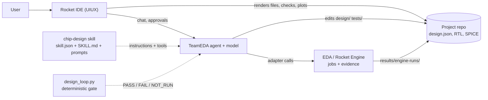

# AI Skill — Hierarchical Chip Design

A **model- and agent-agnostic** skill that turns a natural-language circuit description
into a hierarchical design and verifies every level before descending. It is built for
TeamEDA's own model and agent; no OpenCode behavior is required.

**Status: the loop, structural validator and diagram renderer exist today. Behavioral
verification is delegated to [Rocket Engine](https://github.com/Team-RocketEDA/rocket-engine)
and is only as real as the tools and adapters installed on the machine.**

This repository is not a simulator, a synthesizer or a PDK. It is the design discipline
layer between the user, the agent and the EDA.

## Why

An LLM can draw a plausible block diagram in seconds. That is the easy part and the least
useful one. The hard part is knowing whether the diagram, the RTL and the transistor
netlist still mean the same thing after five rounds of edits.

This skill makes the agent:

- decompose a design level by level instead of one-shot generating it;
- keep every block traceable to a user requirement;
- prove each level with a tool, not with prose;
- repair a failure from evidence, with a bounded number of attempts;
- say `NOT_RUN` or `UNSUPPORTED` when the tool or adapter is missing.

The model proposes. **The loop decides.**

## The loop

```text
edit design.json or an artifact
        |
        v
render diagram -> run design_loop.py -> read NEXT -> act -> repeat
```

`design_loop.py` is the deterministic heartbeat. It runs four stages in a fixed order:

1. **Structure** — `validate_design.py` checks schema, hierarchy, ports, widths, drivers,
   loops and requirement coverage. Any error stops the loop (exit `2`).
2. **Leaf behavior** — each leaf runs its non-`struct.*` checks. Missing adapter, binary or
   malformed reply is `NOT_RUN` (exit `4`), never a pass. A leaf at `rtl`, `gate` or
   `transistor` with only `struct.*` checks is also `NOT_RUN`.
3. **Parent composition** — a parent's behavioral checks run only after every child passes.
   A parent with a failing descendant is `SKIPPED`, not guessed.
4. **Descent** — a passing leaf below `target_level` returns `decompose` (exit `3`). Only a
   full pass at the target returns `complete` (exit `0`).

| `NEXT` | Meaning | Exit |
|---|---|---|
| `repair <blocks>` | a check ran and failed | `1` |
| `provide_check <ids>` | no adapter or tool, so the check did not run | `4` |
| `decompose <block> (level -> next)` | the leaf passed and is below target | `3` |
| `complete` | every leaf reached target with passing checks | `0` |

The agent never chooses the next level. It edits, runs the loop, and does what `NEXT` says.

## How it fits



The skill owns the hierarchy, contracts and gate order. The agent owns judgment and edits.
The EDA owns measurements and verdicts. The IDE renders what is on disk.

`skill.json` is the integration contract: entry point, tool scripts, prompts, references,
required Python version and exit codes. Any agent that can load a JSON manifest, read
markdown and run a Python script can use this skill.

## Install and use

Copy the skill directory into the project, or point the agent's skill loader at it:

```bash
cp -r .opencode/skills/chip-design <project>/skills/
```

Then have the agent:

1. load `skills/chip-design/skill.json` and `SKILL.md`;
2. write `design/design.json`;
3. run `python skills/chip-design/scripts/design_loop.py design/design.json`;
4. follow `NEXT` until `complete` or blocked.

The `.opencode/skills/chip-design/` location is kept because OpenCode discovers skills
there. OpenCode is optional; nothing in `SKILL.md`, the prompts or the scripts depends on
it.

Prerequisite: Python 3.11+. The scripts use only the standard library.

## Worked example

[`examples/alu8/design.json`](.opencode/skills/chip-design/examples/alu8/design.json) is the
Stage 1–2 output for an 8-bit ALU: five requirements, six blocks, fifteen connections.

```text
OK alu8: 6 blocks, 15 connections, 5 requirements, target transistor
alu [architecture] GENERATED
  arith [architecture] GENERATED
  decode [architecture] GENERATED
  flags [architecture] GENERATED
  logic [architecture] GENERATED
  select [architecture] GENERATED
```

The structure is valid. The loop still refuses to descend because no behavioral adapter is
configured on this machine:

```text
chip-design loop: alu8 | target transistor
structure: OK (6 blocks, 15 connections)
LEVEL architecture: 0/6 PASS
  [SKIPPED] alu
  [NOT_RUN] decode
    func.truth_table: NOT_RUN no adapter configured
  ...
NEXT: provide a check adapter for func.arithmetic, func.truth_table
```

That exit `4` is the point: an unproven level is not a passed level.

Try it:

```bash
python .opencode/skills/chip-design/scripts/validate_design.py \
  .opencode/skills/chip-design/examples/alu8/design.json

python .opencode/skills/chip-design/scripts/render_diagram.py \
  .opencode/skills/chip-design/examples/alu8/design.json \
  --out design/diagrams/alu.mmd

python .opencode/skills/chip-design/scripts/design_loop.py \
  .opencode/skills/chip-design/examples/alu8/design.json
```

## Files

| Path | Owner | Meaning |
|---|---|---|
| `design/design.json` | agent | canonical requirements, hierarchy, ports, connections, traceability |
| `design/*.v`, `design/*.sv` | agent | RTL artifacts referenced by blocks |
| `design/*.cir`, `design/*.sp` | agent | SPICE artifacts referenced by blocks |
| `design/diagrams/*.mmd` | derived | Mermaid diagrams rendered from `design.json` |
| `design/checks.json` | user/CI | trusted adapter config — read-only to the agent |
| `tests/` | agent | independent testbenches and vectors |
| `constraints.yaml` | user | targets, measurement formulas, iteration limit — read-only |
| `results/` | engine | evidence and waveforms — read-only |
| `ip/manifest.yaml` | engine | block registry — read-only |

`design.json` records plan state (`PENDING`, `GENERATED`, `NEEDS_CLARIFICATION`,
`BLOCKED`), never a verdict. The validator rejects `VERIFIED` and `FAILED`.

## Abstraction levels

| Level | Artifact | Verified by |
|---|---|---|
| `spec` | requirements + acceptance criteria | structure; each requirement testable |
| `architecture` | blocks, ports, connections, contracts | structural validator + requirement coverage |
| `rtl` | Verilog/SystemVerilog + testbench | compile/lint + independent vectors |
| `gate` | Boolean network or mapped netlist | equivalence under a named library |
| `transistor` | SPICE netlist + models | DC/AC/transient vs constraints |

Different branches may stop at different levels. The report names the frontier; it does
not pretend the whole design reached the target.

## Checks and evidence

`design/checks.json` maps a check id to a command adapter:

```json
{
  "checks": {
    "func.truth_table": {
      "command": ["python", "tools/check_truth_table.py",
                  "--design", "{design}", "--block", "{block}", "--check", "{check}"],
      "timeout": 120
    }
  }
}
```

The command prints one JSON result:

```json
{"status": "PASS", "checks": [{"id": "func.truth_table", "status": "PASS", "evidence": "run-17"}]}
```

`struct.*` checks are built in. Everything else needs an adapter. A missing adapter is
`NOT_RUN`, never `PASS`. Full protocol:
[`references/eda-adapter.md`](.opencode/skills/chip-design/references/eda-adapter.md).

Check statuses: `PASS`, `FAIL`, `NOT_RUN`, `UNSUPPORTED`. A status is only valid when the
loop or the EDA produced it for the current design. Stub or replay results carry that label.
See [`references/verification.md`](.opencode/skills/chip-design/references/verification.md).

## What the skill contains

```text
.opencode/skills/chip-design/
  skill.json                   model/agent integration contract
  SKILL.md                     loop-first agent instructions
  prompts/
    01-spec.md                 requirements + root boundary, JSON-shaped
    02-decompose.md            one level, parent contract preserved
    03-repair.md               evidence -> hypothesis -> smallest edit
    04-report.md               report from loop output, no invented numbers
  references/
    hierarchy.md               data model, levels, decomposition rules
    verification.md            gate order, statuses, evidence, invalidation
    eda-adapter.md             check protocol + RocketEDA mapping
  scripts/
    design_loop.py             deterministic level gate (exit 0/1/2/3/4)
    validate_design.py         structural + traceability validator
    render_diagram.py          Mermaid diagram from design.json
  examples/alu8/design.json    worked architecture example
  tests/                       27 unit tests
```

## Repository status

| Capability | Status |
|---|---|
| `skill.json` contract, `SKILL.md`, four stage prompts | **Implemented** |
| Deterministic loop with structure → leaves → parents → descent | **Implemented**, 10 tests |
| `design.json` structural validator | **Implemented**, 13 tests |
| Mermaid diagram renderer | **Implemented**, 4 tests |
| ALU architecture example | **Implemented** (architecture only) |
| EDA adapter protocol | **Implemented**; adapters are project-specific |
| Rocket Engine integration | **Delegated**; `run_spice` is the implemented job kind |
| RTL generation and simulation | **Planned** — needs a digital engine job or local tool |
| Gate-level equivalence | **Planned** — needs Yosys and a target library |
| PDK, DRC/LVS, layout, timing/power closure | **Out of scope** |

## Limits

- The engine's MCP bridge is on a branch; the default runner is a stub. Stub results are
  labelled and are not simulations.
- `run_spice` is the implemented job kind. Digital RTL/gate jobs do not exist yet, so those
  checks are `NOT_RUN` or `UNSUPPORTED` until `engine_list_job_kinds` says otherwise.
- No PDK ships with this repo. Transistor-level output without one is generic/educational,
  not foundry-ready.
- The validator and loop check structure and check results, not timing, power, area or
  manufacturability.
- The loop reruns adapters on every invocation; it does not maintain a result database.
  Persisting evidence is the EDA's job.
- The IDE schematic is drawn from SPICE netlists; a digital hierarchy is visible through
  files and the report, not a schematic drawing.
- Photonic design is not covered.

## Tests

```bash
python -m unittest discover -s .opencode/skills/chip-design/tests -v
```

27 tests: validator invariants (13), loop gate order and fail-closed behavior (10), diagram
rendering (4).

## Roadmap

| Phase | Outcome |
|---|---|
| P0 | repository and toolchain assessment (done) |
| P1 | skill, canonical model, validator, loop, prompts, renderer (done) |
| P2 | benchmark circuits + decomposition behavior |
| P3 | RTL emission + independent vectors; engine digital job |
| P4 | gate-level netlist + Yosys equivalence |
| P5 | fixed CMOS primitive library + ngspice checks |
| P6 | agent/IDE integration, install script, end-to-end evals |

Details, acceptance criteria and risks: [`IMPLEMENTATION_PLAN.md`](IMPLEMENTATION_PLAN.md).

## Contributing

Keep the gate order and the honesty rules. A change that lets the agent claim a pass
without a current check result will be rejected. Add a benchmark circuit and its expected
verdicts with any behavioral change. Keep the scripts stdlib-only; do not add a dependency
for something the standard library already does.

## License

No license file exists in this repository.
